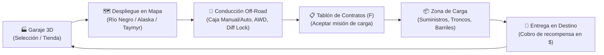

# 🏔️ SnowRunner Godot 4.6 — Simulador Off-Road Modular

[](https://godotengine.org)
[](https://microsoft.com/windows)
[](LICENSE)
[](https://github.com/cesaralejandromartesbonilla-a11y/snowrunner-godot)

Recreación fiel y modular de la jugabilidad y mecánicas de **SnowRunner** en **Godot 4.6 (Forward Plus)** utilizando la física nativa de `VehicleBody3D`, caja de cambios secuencial, tracción AWD/Diff Lock, detección dinámica de 14 tipos de terreno, acople físico de remolques y logística de contratos.

---

## 🎯 Bucle de Juego (Gameplay Loop)



---

## 🚀 Cómo Ejecutar el Proyecto

1. **Requisitos:** Godot Engine 4.6 (o superior) con renderizador Forward Plus.
2. **Escena Principal (`F5`):**
   - [`res://gameplay/ui/menu_principal.tscn`](file:///c:/Users/cesar/Desktop/games/backup/GodotProjects/00_Active/snowrunner-godot/gameplay/ui/menu_principal.tscn) — Accede al Garaje 3D con 5 bahías interactivas, tienda de vehículos, almacén de remolques y selector de mapas.
3. **Ejecución directa de mapas (`F6`):**
   - **Río Negro (Michigan):** `res://gameplay/maps/rio_negro.tscn` (200x200m, asfalto, barro medio, 4 contratos, 3 atalayas).
   - **Alaska:** `res://gameplay/maps/alaska.tscn` (Nieve, hielo resbaladizo, 2 contratos, 2 atalayas).
   - **Taymyr (Siberia):** `res://gameplay/maps/taymyr.tscn` (Barro extremo, pantano denso, 2 contratos).

---

## 1. Lo Implementado y Funcional (Ecosistema 1)

### 1.1 Controlador del Vehículo (`camioneta.gd`)
- **VehicleBody3D nativo:** Simulación de masa, suspensión independiente por rueda y centro de masa calibrado.
- **Caja de cambios secuencial realista:** `R (-3)`, `N (-2)`, `L (-1)`, `1 (0)`, `2 (1)`, `3 (2)`, `4 (3)`.
- **Modos de transmisión:**
  - **Automático:** Shifting inteligente por curva de velocidad lineal y demanda de acelerador.
  - **Manual:** Control secuencial directo con `Shift` (subir) y `Ctrl` (bajar).
- **Curva de potencia y torque:** Cálculo dinámico de RPM en función de la relación de marcha y velocidad de ruedas.
- **Tracción AWD y Bloqueo de Diferencial:**
  - Restricciones según `VehicleStats` (`ALWAYS_ON`, `SWITCHABLE`, `UPGRADE_NEEDED`, `NONE`).
  - Penalización de consumo realista: AWD (+15%), Diff Lock (+5%), Marcha Low (+20%).
- **Consumo y gestión de combustible:** Vaciado de depósito en tiempo real y apagado del motor al agotarse.
- **Detección de terreno por rueda:** Integración con `WheelTerrainDetector` para fricción y resistencia dinámica.
- **Sistema de acople de remolques:**
  - Detección de proximidad mediante `PuntoAcopleRemolque` / `QuintaRueda`.
  - Generación y liberación en tiempo de ejecución de `ConeTwistJoint3D`.
  - Exclusión de colisiones mutuas entre tractor y remolque acoplado.

---

### 1.2 Catálogo de 6 Vehículos (`VehicleStats` Resources)

| Vehículo | Archivo Escena | Clase | Masa | Depósito | AWD | Bloqueo Diff | Precio |
| :--- | :--- | :--- | :--- | :--- | :--- | :--- | :--- |
| **Chevrolet CK1500** | `ck1500.tscn` | Scout | 2,000 kg | 80 L | Conmutable | Mejora | Gratis (Inicial) |
| **Fleetstar F2070A** | `fleetstar.tscn` | Heavy Duty | 6,300 kg | 240 L | Mejora | Conmutable | $800 |
| **Azov 67096 Atom** | `atom.tscn` | Heavy | 15,528 kg | 350 L | Conmutable | Siempre Activo | $2,500 |
| **Kirovets K-700** | `k700.tscn` | Especial (Articulado) | 12,008 kg | 340 L | Siempre Activo | Conmutable | $2,000 |
| **Pacific P16** | `p16.tscn` | Super Heavy | 25,000 kg | 300 L | Sin AWD (RWD) | Siempre Activo | $3,500 |
| **KOLOB 74941** | `kolob.tscn` | Super Heavy | 26,500 kg | 340 L | Conmutable | Conmutable | $4,000 |

---

### 1.3 Sistema de Terrenos (`TerrainManager` & `WheelTerrainDetector`)
- **14 tipos de terreno soportados:** Asfalto, Tierra, Barro (Ligero/Estándar/Profundo/Extremo), Nieve (Estándar/Profunda), Hielo, Agua (Poco/Media/Profunda), Roca.
- **Fricción y resistencia dinámica:** Resistencia aplicada por fuerza central según profundidad de barro o nieve.
- **Daño por inmersión en agua:** Entrada de agua profunda genera pérdida de combustible o ahogamiento del motor.
- **`TerrainZone` (Area3D):** Volúmenes espaciales en los mapas que inyectan el tipo de superficie a los detectores de rueda.

---

### 1.4 Sistema de Remolques (Trailers)
- **`TrailerData` Resource:** Definición de masa física, precio, slots de carga y tipo de acople.
- **3 variantes de remolque:**
  - `trailer_basico.tscn` (1,500 kg): Remolque de arrastre ligero sin slots.
  - `trailer_carga.tscn` (2,000 kg): Plataforma de carga de 4 slots.
  - `trailer_carga_largue.tscn` (3,500 kg): Plataforma extendida de 6 slots para cargas pesadas.
- **`TrailerManager` (Autoload):** Compra, inventario de patio, despacho y enganche.
- **Trailer Spawner HUD (`Tecla Y`):** Despliegue de remolques en tiempo real en los puntos de spawn.
- **Patio de remolques 3D:** Vista previa interactiva en el Garaje.

---

### 1.5 Logística de Carga y Contratos
- **`ContratoManager` (Autoload):** 8 contratos con recompensas económicas distribuidos en los 3 mapas.
- **Tipos de carga:** `suministros.tres`, `troncos.tres`, `combustible.tres`, `repuestos.tres`.
- **`ContractBoard`:** Tablón interactivo (`F`) para aceptar o cancelar contratos.
- **`ContractMarker` / `CargoLoadingZone`:** Zonas delimitadas para carga y descarga de slots en camión o remolque.
- **`ContractHUD`:** Brújula orientada hacia el objetivo activo con distancia métrica en tiempo real.

---

### 1.6 UI, Instrumentación y Garaje
- **Garaje 3D con 5 bahías:** Navegación orbital de cámara y selección de vehículos.
- **Paneles de gestión:** Tienda de camiones, Almacén infinito, Selección de mapas, Reparación ($50) y Repostaje ($20).
- **HUD de instrumentos en cabina:** Velocímetro, Tacómetro de RPM, Indicador de Combustible, Marcha actual y Estado de AWD/Diff Lock.

---

## 2. Decadencias Conocidas y Áreas de Mejora

A pesar de que el juego es completamente jugable, existen limitaciones técnicas identificadas:

### ⚠️ Física de Ruedas y Geometría
1. **Offsets de ruedas desalineados:** El **CK1500** tiene las ruedas alineadas con su malla original. En los otros 5 vehículos (`fleetstar`, `atom`, `k700`, `p16`, `kolob`), las posiciones de `VehicleWheel3D` requieren calibración fina para evitar flotación visual o volcaduras prematuras.
2. **Radio de ruedas hardcodeado:** `wheel_radius` debe sincronizarse dinámicamente desde `VehicleStats`.
3. **K-700 Articulado:** En `gameplay/vehicles/k700.tscn` opera con chasis rígido; la versión articulada de 2 cuerpos (`k700_articulado.tscn`) está aislada en pruebas.
4. **Resistencia de terreno aplicada al centro de masa:** La fuerza de arrastre del barro se aplica centralmente en lugar de calcularse vectorialmente rueda por rueda.

### ⚠️ Remolques y Acople
1. **Inestabilidad del `ConeTwistJoint3D`:** A velocidades elevadas o sobre terrenos rocosos, el joint físico puede presentar tirones (*jittering*).
2. **Spawn a nivel de suelo:** El punto de spawn debe estar elevado al menos 0.5m sobre el terreno para evitar interpenetración de colisiones.

### ⚠️ Transmisión, Winch y Efectos
1. **Transición brusca a Reversa:** Al mantener presionado el freno en modo automático, el paso de 1 a R puede oscilar en pendientes pronunciadas.
2. **Winch lógico sin cable visual:** El sistema de rescate opera de forma lógica sin cuerda física simulada.
3. **Audio de motor y partículas:** Falta modulación de pitch de motor en tiempo real y emisores de partículas de salpicadura de barro.

---

## 3. Mapeo de Controles (Input Map)

| Acción | Tecla | Función |
| :--- | :---: | :--- |
| **Acelerar** | `W` | Aplica torque motor |
| **Frenar / Reversa** | `S` | Freno de servicio / Retroceso |
| **Dirección** | `A` / `D` | Giro de ruedas directrices |
| **Freno de Mano** | `Espacio` | Freno de estacionamiento en ruedas traseras |
| **Encender / Apagar Motor** | `E` | Alterna el encendido del motor |
| **Subir Marcha (Manual)** | `Shift` | 1 → 2 → 3 → 4 |
| **Bajar Marcha (Manual)** | `Ctrl` | 4 → 3 → 2 → 1 → L → N → R |
| **Modo Auto / Manual** | `T` | Alterna lógica de transmisión automática y manual |
| **Activar/Desactivar AWD** | `Z` | Alterna tracción integral (si el vehículo lo permite) |
| **Bloqueo Diferencial** | `X` | Alterna bloqueo de diferencial (si disponible) |
| **Interactuar / Cargar** | `F` | Tableros, Gasolineras, Zonas de Carga, Acople de remolque |
| **Desplegar Remolques** | `Y` | Abre el menú emergente del Spawner de Remolques |
| **Menú / Pausa** | `Esc` | Pausa el juego o regresa al menú principal |

---

## 4. Estructura de Directorios

```
snowrunner-godot/
├── autoloads/
│   ├── global_data.gd          # Dinero, slots de garaje, inventario, save/load
│   ├── terrain_manager.gd      # 14 tipos de terreno, fricción y daño
│   ├── contrato_manager.gd     # Gestión de contratos y recompensas
│   ├── trailer_manager.gd      # Compra, posesión y despacho de remolques
│   └── recovery_manager.gd     # Lógica de rescate y autorrescate
├── gameplay/
│   ├── main.gd                 # Controlador del nivel en curso y HUD
│   ├── vehicles/
│   │   ├── camioneta.gd        # Controlador unificado VehicleBody3D
│   │   ├── vehicle_body.gd     # Script base auxiliar
│   │   ├── resources/          # VehicleStats, TrailerData, AddOnData
│   │   ├── components/         # WheelTerrainDetector, ArticulatedJoint, AddOnComponent
│   │   ├── trailers/           # Escenas y recursos de los 3 remolques
│   │   └── *.tscn              # Escenas de los 6 vehículos jugables
│   ├── maps/
│   │   ├── rio_negro.tscn      # Mapa Río Negro (Michigan)
│   │   ├── alaska.tscn         # Mapa Alaska (Nieve y Hielo)
│   │   └── taymyr.tscn         # Mapa Taymyr (Siberia - Pantano)
│   ├── cargo/                  # CargoData, ContractBoard, ContractMarker, Zonas de carga
│   ├── world/                  # Gasolineras, Gateways, Atalayas (Watchtowers)
│   └── ui/                     # Garaje 3D, Tienda, Almacén, Selector de Mapas, HUDs
├── data/
│   ├── vehicles/*_stats.tres   # Recursos de estadísticas por vehículo
│   └── surfaces/               # Materiales físicos de terreno
├── testing/                    # Módulos de física experimental (NO MEZCLAR CON GAMEPLAY)
└── legacy/                     # Archivos históricos preservados para referencia
```

---

## 5. Regla de Oro de Arquitectura

- **`gameplay/` (Ecosistema 1):** Basado exclusivamente en el nodo `VehicleBody3D` nativo de Godot 4.6 para máxima estabilidad y compatibilidad.
- **`testing/` (Ecosistema 2):** Contiene prototipos de chasis segmentados, suspensión modular por código y cajas de torsión. No deben importarse directamente a `gameplay/` sin aislar sus dependencias.
